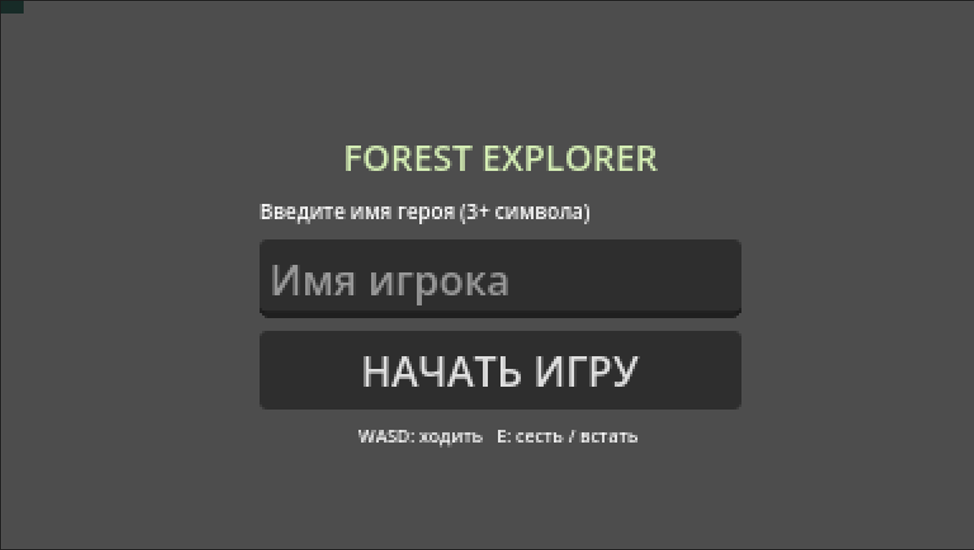
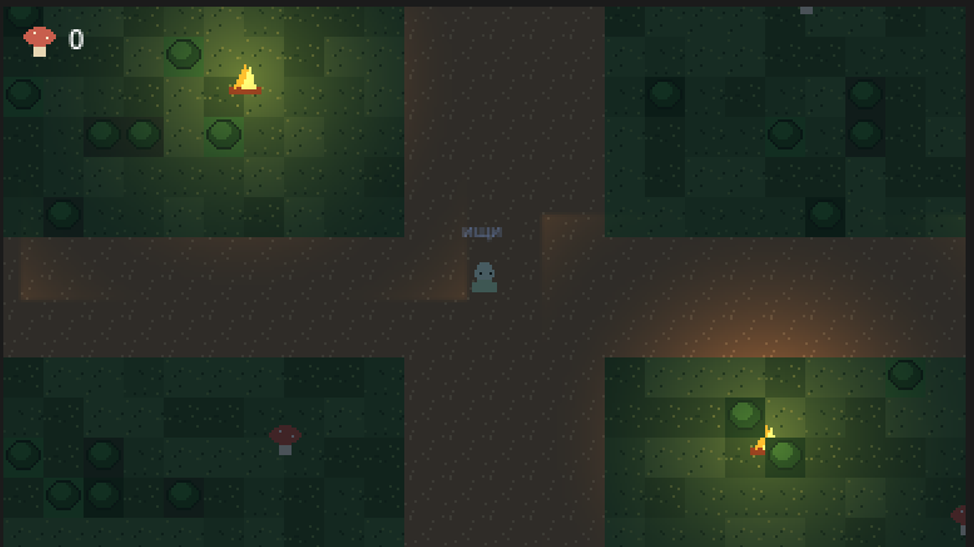
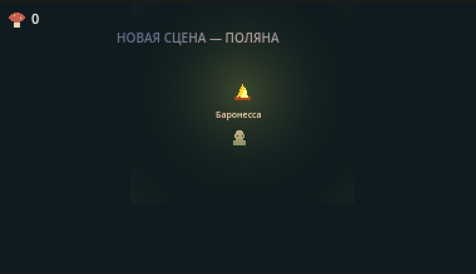

# 02_FOREST_EXPLORER

**Дата:** 12.11.2026  
**Автор (ФИО):** Сурков Тимофей Витальевич, Корольков Иван Сергеевич 

## Описание проекта
Продолжение исходного проекта `01_DIGITAL_UI_CARD`: создана пиксельная 2D-игра на Godot 4.x с лесной картой, персонажем, анимацией ходьбы и сидения, костром, сбором грибов, интерфейсом и переходом на другую сцену. Исходные сцены и скрипты UI-карточки сохранены в проекте.

## Запуск
Откройте `project.godot` в Godot 4.3+ и запустите F6/F5. Главная сцена — `scenes/Start.tscn`.

## Управление
- WASD / стрелки — перемещение
- E — сесть / встать (сидя движение блокируется)
- Для сбора гриба подойдите к нему
- Для перехода на поляну войдите в область `>>` справа на карте

## Стек проекта
- **Движок:** Godot Engine 4.x (Compatibility)
- **Язык:** GDScript

## Что использовано
- **Узлы:** TileMapLayer (Ground, Plants, Walls), CharacterBody2D, Camera2D, AnimatedSprite2D, Area2D, CollisionShape2D, CanvasLayer, CanvasModulate, PointLight2D
- **Паттерны:** автозагрузка `Global.gd`, сигнал `item_collected`, отдельные сцены объектов
- **Ресурсы:** самостоятельно нарисованные пиксельные тайлы, спрайты персонажа, костра, грибов и радиальная текстура света

## Самостоятельные работы
- **Имя игрока:** Да, проверка длины имени (минимум 3 символа), отображение над персонажем
- **Переход на другую сцену:** Да, Area2D у правой границы карты
